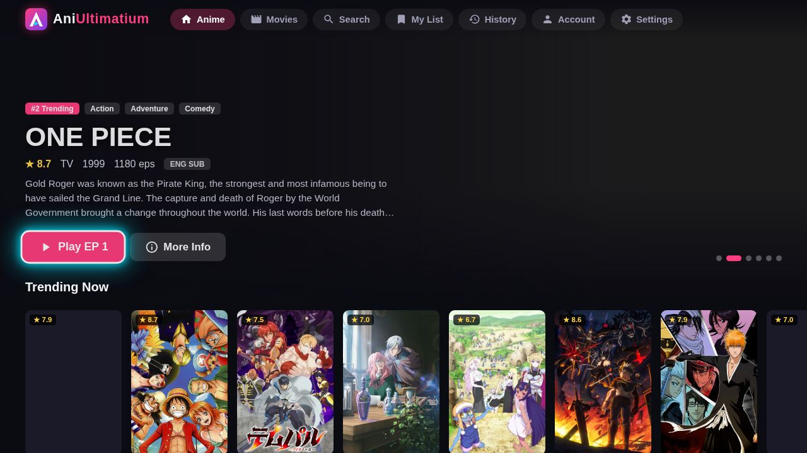
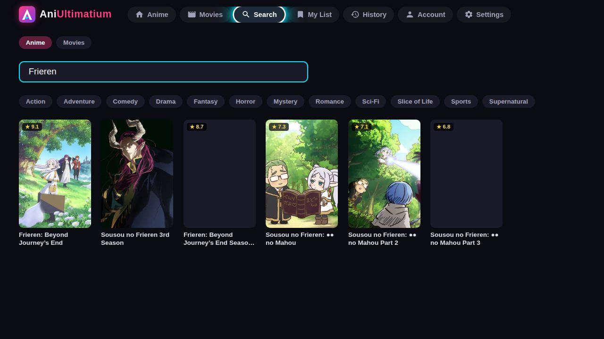
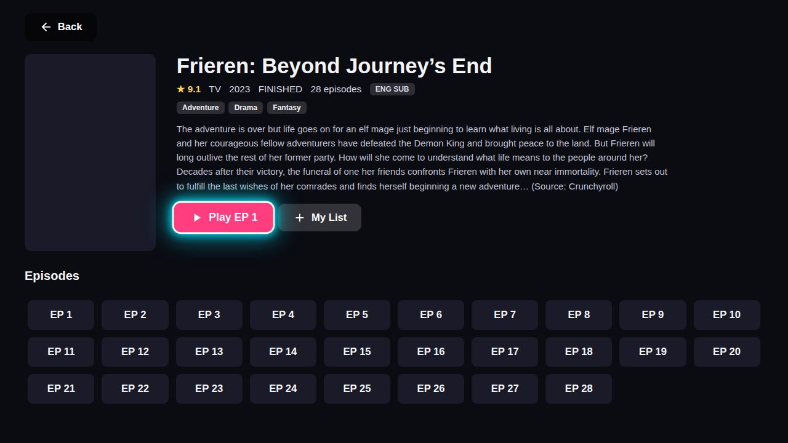
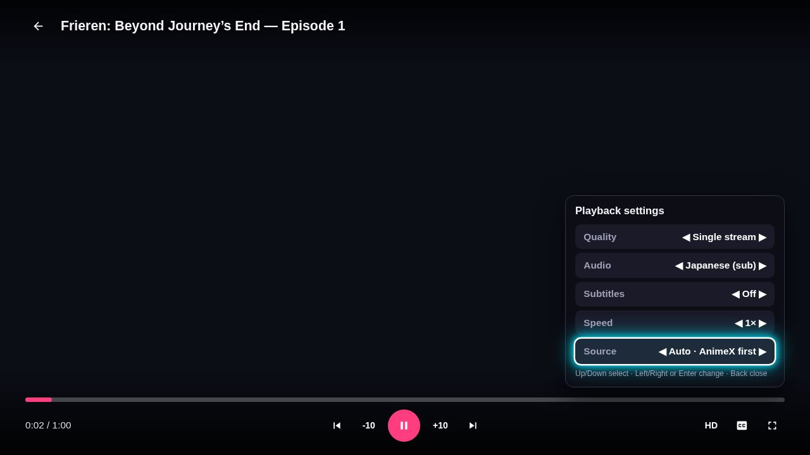

# Aniultimatium — English sub & dub anime app for Samsung Tizen smart TVs

> **Free, open-source anime streaming app built for Samsung Tizen TVs (2018 / Tizen 4.0 and newer)** — English subtitles, English dub, a remote-first interface,
> automatic source switching and AniList sync. The same code also runs in any laptop or desktop browser.
> Our goal: to be the best English sub and dub anime app for Samsung Tizen TVs.

This app combines all anime apis into one.

[](https://github.com/AdvaithAvinash/AniUltimatium/releases/latest)
[](#install-on-a-samsung-tv)
[](#faq)
[](#anilist)
[](https://github.com/AdvaithAvinash/AniUltimatium/commits/main)

[Download the latest `app.wgt`](https://github.com/AdvaithAvinash/AniUltimatium/releases/latest) · [Install guide](#install-on-a-samsung-tv) · [FAQ](#faq) · [Developer docs](#developer-documentation) · [Website](https://aniultimatium.advaithavinash404.workers.dev/about)

## Quick facts
| | |
|---|---|
| **What it is** | Anime streaming client for Samsung smart TVs (Tizen web app, `.wgt`) and web browsers |
| **TV support** | Samsung Tizen 4.0 (2018) and newer. Layout and scrolling are checked against a Chromium 56 engine, the browser inside Tizen 4 TVs |
| **Languages** | English subtitles (OpenSubtitles auto-picked, 15+ other languages) and English dub where a source has one; Japanese audio by default |
| **Control** | Built for the 10-key remote: arrows, OK, Return, media keys. Mouse and keyboard work on a laptop |
| **Sources** | AnimeX (default), AniKoto, AnimeYubi, AniWaves, ranked automatically from real playback results on *your* TV (SourceIQ) |
| **Accounts** | Optional sync of Continue Watching / My List / History, and optional [AniList](https://anilist.co) linking |
| **Movies & TV** | Movies and TV Shows tabs (seasons, episodes, next episode) with CineSrc, VidFast, VidCore, Videasy and public-domain films. Those hosted players need a 2020+ browser, so on Tizen 4–6 TVs only public-domain films play; the app tells you instead of hanging |
| **Cost** | Free. No ads in our own player. Hosted on a free Cloudflare Worker, or run it at home with `npm start` |
| **Install** | Sideload `app.wgt` with [Apps2Samsung](https://github.com/Apps2Samsung/Apps2Samsung/releases) (no Samsung store account needed) |

## Screenshots
| Home | Search |
|---|---|
|  |  |

| Show page with episodes | Player settings: audio sub/dub, subtitles and source status |
|---|---|
|  |  |

## Why choose Aniultimatium on a Samsung TV
- **Made for Tizen first.** Most anime apps target phones or PCs. This one is a Tizen web app: remote navigation, TV-safe layout, hardware Back key, and an
  old-engine compatibility layer so it also works on 2018 TVs (v1.04 fixed a "no video / no scrolling" bug on Tizen 4).
- **English sub *and* dub.** Switch Japanese / English dub in the player (Up, then Audio), pick any subtitle language, nudge subtitle timing by ±0.5 s, and move subtitles up or down (low by default) or change their size.
  The app falls back to Japanese audio automatically when a dub does not exist yet.
- **Sources that fix themselves (SourceIQ).** The app records which source actually *plays* on your TV (resolution success, first-frame time, errors),
  ranks sources by that, cools down a failing source and brings it back automatically. The source menu shows *Recommended / Reliable / Untested / Temporarily unavailable*.
  Nothing is faked: with no history every source says "Untested".
- **Fast source discovery (TurboScrape).** Sources are raced with per-source time limits, the next source starts early when the first is slow, lookups are cached and
  de-duplicated, abandoned lookups are cancelled, and the next episode is prepared while you watch. See [measured results](#performance-measured).
- **AniList sync.** Link AniList with a code from your phone; finishing an episode updates your progress and your "Watching" list shows on the home page.
- **Movies and TV shows too.** Movies and TV Shows tabs with "Popular This Week" and "New Releases", several players, OpenSubtitles, and a Down-key control bar for seeking.
- **What's new each week.** "Popular This Week" and "New Releases" rows built from the episodes that actually aired in the last 7 days.
- **Open and self-hostable.** The whole project, including the backend and the tests, is in this repository.

## Install on a Samsung TV
1. Download `app.wgt` from the [latest release](https://github.com/AdvaithAvinash/AniUltimatium/releases/latest).
2. Use apps2samsung: https://github.com/Apps2Samsung/Apps2Samsung/releases to install, use custom wtg file and install. Thanks to apps2samsung without it the project would not have been possible.
3. Open **Aniultimatium** on the TV. (The first start shows the controls; "Don't show again" hides it.)

Samsung TVs need Developer Mode for sideloading (Apps screen, type 12345, Developer mode ON, enter your computer's IP, reboot). Apps2Samsung walks through it.

## FAQ
**What is the best anime app for Samsung smart TVs?**
It depends on what you need. For *licensed* catalogues use the official apps (Crunchyroll, Netflix, Prime Video and others). If you want a **free, open-source anime app
built specifically for Samsung Tizen TVs, with English sub and dub, remote-first controls, automatic source fallback and AniList sync**, Aniultimatium is made for exactly that,
and that is the gap it is designed to be the best at. Phone/PC apps and website wrappers generally are not built for a TV remote or for Tizen's older browser.

**Does it work on older Samsung TVs (2018, Tizen 4.0)?**
Yes, that is a design goal. Tizen 4 TVs use Chromium 56, which lacks CSS `inset`, flex `gap`, CSS grid and more; the app detects this and uses fallbacks, and
`python3 tools/check_compat.py` fails the build if newer-only CSS/JS is added. If something still looks wrong, open an issue with your TV model and year.
Anime plays normally. Movies and TV shows are the exception: they open other sites' players, whose code needs a 2020 or newer browser (Chromium 80+), so on Tizen 4 to 6 only public-domain films play;
the app shows a message instead of hanging on "fetching media". Tizen 4 also gets Lite mode and lazy-loaded pictures automatically (home page download measured at 22 MB → 0.8 MB).

**Does it have English dub?**
Yes, where a source offers one: open the player menu (Up), then **Audio**, then English dub. In our latest tests 49 of 59 popular and current-season shows had an English dub on at least one source; the rest do not have a dub yet.

**Is it free? Is it legal?**
The app is free and open source. It does not host any video: it looks up streams that third-party sites publish and plays them. Availability and legality of that content
depend on your country and on those sites; you are responsible for what you watch. The project is not affiliated with any streaming service, AniList or Samsung. Please support official releases when you can.

**Why does a show not play?**
Sources differ per title. Open the player menu, then **Source**, to try another; the app also switches by itself if a stream does not start within about 25 seconds.
`/api?action=debug&id=<AniList id>&title=<title>&ep=1` on your server shows what each source returned.

**How do I link AniList?** Account, then AniList, then *Link AniList*; open the address shown on the TV on your phone and enter the code. Details in [AniList](#anilist).

**Can I run it without Cloudflare?** Yes: `npm install && npm start` on a computer on your Wi-Fi, then enter its address in the TV app (Settings, Stream server). A home IP is the most reliable for streaming sites.

## Performance (measured)
`tools/bench_sources.js` compares the old behaviour (`?turbo=0`) with TurboScrape **on the same live Cloudflare Worker, interleaved**, following the same retry loop the app uses.
Time = until a usable (playlist-verified) stream is returned; 12 popular shows, 3 rounds, 36 samples per cell, run from a cloud server (absolute numbers depend on network and time of day):

| Scenario | Old: median / slowest 10% | New: median / slowest 10% |
|---|---|---|
| Cold lookup (first AnimeX answer) | 760 ms / 8.6 s | 695 ms / 3.9 s |
| Same episode again | 675 ms / 1.1 s | 74 ms / 1.5 s |
| AnimeX failing (falls to the next source) | 2.5 s / 7.0 s | 2.3 s / 6.4 s |
| AnimeX and AniKoto failing | 2.5 s / 9.5 s | 2.1 s / 4.5 s |

An earlier identical run showed a cold median of 1.5 s to 0.7 s and slowest-10% of 16.8 s to 5.2 s. The reliable gains are in the *slow tail* (a slow source no longer blocks the next one) and in repeats;
when the first source is already fast there is little left to save. Time to first video frame depends on the TV and is recorded on-device by SourceIQ; it cannot be measured from a server.

---

# Developer documentation

- `public/` is the front-end and the TV app. `public/iq.js` is SourceIQ, `public/main.js` the app.
- `api/index.js` is the backend (AniList metadata, stream lookup, relay); it runs on Cloudflare Workers (`worker/index.js`), Vercel or Node (`server/local.js`).
- `lib/turbo.js` is TurboScrape (cache, de-duplication, hedged race, cancellation).
- `tools/build_wgt.py` zips `public/` into `app.wgt`; `tools/check_compat.py` is the old-TV compatibility check; `tools/gen_compat_css.py` generates the CSS fallbacks;
  `tools/bench_sources.js` is the latency benchmark. Tests: `npm test`.

Set `VERCEL_API_URL` at the top of `public/main.js` (any backend URL), then run `python3 tools/build_wgt.py`.

## TurboScrape and SourceIQ
**TurboScrape** (`lib/turbo.js`, used by `api/index.js`):
- *Hedged race*: the best source starts first; if it has not answered after a short, self-adjusting delay the next source starts too (at most two at a time), the first playable result wins and the loser is cancelled.
  A failure starts the next source immediately. Every source has its own time limit.
- *Request budget*: each source's real number of outgoing requests is learned; heavy sources (AniKoto and AniWaves use 15-90 per call, the Workers free plan allows about 50) never overlap with others.
- *Caching*: AniList results 5 min (a host that blocks AniList is remembered for 10 min), AnimeX show lookup 30 min, AnimeYubi searches 6 h, episode data 3 min, a verified result 45 s. Concurrent identical lookups share one execution.
  Media links are never kept longer than that, so links do not go stale. Bounded to 300 small entries.
- *Cancellation*: outgoing requests are tied to the client request; when the app leaves the episode (or a race is lost) the work is aborted. The app also aborts abandoned lookups where the browser supports `AbortController` (Tizen 4 does not; stale answers are ignored there).
- Responses include a `trace` (per source: ok / failed / timeout / absent / cancelled and milliseconds, never URLs) and `ms` / `n` (time, outgoing requests). `?turbo=0` runs the pre-TurboScrape behaviour for comparison.

**SourceIQ** (`public/iq.js`, stored on the device under `ea_iq`):
- Records per source: *resolution* outcomes from the backend trace, and *playback* outcomes measured on the TV (first frame reached and time to first frame, fatal errors, stalls). A show missing from a source is not counted against it.
- Score = 0.50 x smoothed playback success + 0.25 x smoothed resolution success + 0.15 x speed + a small default preference that fades as evidence grows; evidence halves every 24 h.
- Two playback failures in a row (or three resolution failures) start a **cool-down** (2 min, doubling up to 30 min); the source is ranked last, can still be picked manually, recovers automatically, and one failure while recovering trips it again. A success clears it.
- The ranking is sent as `order=` with each lookup; the source menu shows *Recommended / Reliable / Untested / Temporarily unavailable*. No URLs, cookies or titles are stored.
- If a backend call dies without any answer (for example Cloudflare's CPU limit, error 1102) the app drops the lead source and asks again.

## Deploy on Cloudflare Workers (works while Vercel is paused)
The same `api/index.js` backend runs as a Cloudflare Worker (`worker/index.js` + `wrangler.jsonc`); the Worker also serves `public/`, so one URL covers laptop + TV.
1. Cloudflare dashboard → Workers & Pages → Create → connect this GitHub repo. Build command `npm install`, deploy command `npx wrangler deploy`. The Worker name must be `aniultimatium`.
2. Optional: a KV namespace bound as `STORE` keeps accounts/sync permanently (wrangler creates it on deploy; delete the `kv_namespaces` line in `wrangler.jsonc` if the deploy complains). Without it accounts live in memory only.
3. Put your `https://<name>.<you>.workers.dev` URL in `VERCEL_API_URL` (first line of `public/main.js`) and rebuild the `.wgt`.
Notes: the free plan has a small CPU limit per request, and streaming sites sometimes block Cloudflare IPs; open `/api?action=debug&title=Solo%20Leveling&ep=1` to see what works. `npm start` on a home PC stays the most reliable.

Controls – TV remote: arrows / Enter / Return, media keys. Laptop: mouse, or arrows / Enter / Esc,
`/` search, Space play-pause, ←/→ seek 10s, `N`/`P` next/prev episode, `C` subtitles, `F` fullscreen, `M` mute.

## Troubleshooting streams
Open `https://<your-worker>/api?action=debug&id=154587&title=Frieren&ep=1` (use the show's AniList id): it runs every source (AnimeX, AniKoto, AnimeYubi, AniWaves)
to completion and shows which one worked, how long it took, how many outgoing requests it used (`n`), or why it failed (`kind`: absent = not on that source, fail, timeout, budget).

## Run locally (recommended — streaming sites block cloud IPs)
```
npm install
npm start        # prints http://localhost:3000 and your TV address http://<LAN-IP>:3000
```
Laptop: open `http://localhost:3000`. TV: open the app → **Settings** → *Stream server* → enter the TV address → Save → *Test streams*.
Keep the computer on and on the same Wi-Fi as the TV while watching.

## Stream sources
Anime streams come from four sources, tried one at a time in this order (chosen from tests on a Samsung TV):

1. **AnimeX** (animex.one player API, keyed by AniList id) — default. HLS, sub + English dub, many subtitle languages, intro/outro times.
2. **AniKoto** (via the bundled [Anivexa API](https://github.com/walterwhite-69/Anivexa-API), `all-api` dependency) — HLS 1080p with soft subs.
3. **AnimeYubi** (ZokoAnime host) — HLS 1080p, sub + dub, English VTT.
4. **AniWaves** (via Anivexa) — last resort.

Streams whose CDN needs a Referer are relayed by `/api?action=proxy` (playlists rewritten); subtitle files are converted to WebVTT.
Each stream's playlist is checked from the server before it is handed out. On **Cloudflare Workers** (free plan ≈ 50 outgoing requests
per call) a call that runs low on budget tells the app to continue with `?skip=`; if a stream fails to play or never starts on the TV,
the app moves on to the next source by itself. The next episode is looked up in the background while you watch.
In the player press **Up** for the settings menu (Quality, Audio sub/dub, Subtitles, Subtitle file and sync, Speed, **Source**).
Diagnose from any host with `/api?action=debug&id=<anilistId>&title=<title>&ep=1`.

Evaluated and **not** used (Oct 2026): MiruroAPI (XOR-encoded streams, Miruro blocks Cloudflare), animetsu-api (upstream gone),
consumet.ts (removed from GitHub after DMCA; providers dead or need decryption), REIATSU (repository not found),
AnimeParadise / anv.to (did not play on the TV), hianimes/megaplay and AnimeStream (encrypted / DRM).

## AniList
Link your AniList account in **Account → AniList**. On the TV press *Link AniList*: it shows a 6-letter code and an address
(`<your worker>/link.html`); open it on your phone or laptop, enter the code and sign in with AniList — the TV links itself.
(On a laptop browser on the app's own site, *Link AniList* signs in directly.) Once linked:
- finishing 85% of an episode updates your AniList progress (and marks the show Completed on the last episode; toggle *Auto-update*),
- the home page shows an **AniList · Watching** row (next episode badge),
- a show's page shows your AniList status; press it to cycle Plan to watch → Watching → Completed → Paused → Dropped → remove,
  and *Play* continues from your AniList progress.

One-time setup (AniList requires an API client): go to https://anilist.co/settings/developer → *Create new client*, name it
Aniultimatium, Redirect URL `https://<your worker>.workers.dev/link.html`, save, and put the client **ID** into
`wrangler.jsonc` → `"vars": { "ANILIST_CLIENT_ID": "<id>" }` (or the env var for `npm start`). Linking codes are kept in the
Worker's KV namespace `STORE`.

## Movies, accounts, history
- **Movies** and **TV Shows** tabs: catalogue/metadata from Cinemeta (free, no key); TV shows list seasons and episodes (`/api?action=tv_meta&id=tt…`). Playback: public-domain films from the Internet Archive play in our
  own player (quality/subtitle menu, resume, skip); every other movie opens a hosted embed player in an iframe: **CineSrc** (default), **VidFast**, **VidCore** or **Videasy**.
  On a movie's page, the **Source** dropdown picks Auto / CineSrc / VidFast / VidCore / Videasy / Public domain before you press Play (remembered).
  Embedded players run their own controls, so resume/skip aren't available there. In the menu (Up / Q) choose Source: Auto / Embedded / Public domain.
- **Accounts**: Account tab -> create account / sign in. Continue Watching, My List and History sync between devices.
  Storage: `data/` folder when you run `npm start`; Upstash Redis on Vercel (`UPSTASH_REDIS_REST_URL`, `UPSTASH_REDIS_REST_TOKEN`,
  optional `AUTH_SECRET`). Without Upstash, Vercel only keeps accounts temporarily.
- **Skip intro / outro** (AniSkip) button appears during openings/endings (Enter on the remote, or click).
- **Remove from Continue Watching**: ✕ on the card (mouse), Delete / X / red button on a focused card, or the button on the detail page.
  **History** tab lists everything watched; remove single items the same way or "Clear all history".

## Subtitles, ±10s and quality (movies)
- **OpenSubtitles** (English, up to 6 candidates per title, keyless via Stremio's OpenSubtitles data endpoint) work in our own player and over **CineSrc**:
  CineSrc is driven through its documented postMessage API, so subtitles are drawn locked to its playback clock. Menu (Up / Q): Subtitles (pick a candidate) and
  *Subtitle sync* (±0.5s) if a file is early/late. **VidCore** and **CineSrc**: press **Down** for the control bar (seek bar with time, −10 / play-pause / +10, subtitles, sync, settings, exit); Left/Right skip 10s anytime.
- CineSrc: ±10s with Left/Right on the remote (or the ⟲ 10 / 10 ⟳ buttons), Enter = play/pause, green = cycle subtitles; progress is saved so Continue Watching resumes (`t=`).
- **Quality** dropdown on the movie page: Auto, 4K, 1440p, 1080p, 720p, 480p (sent to CineSrc as `quality=`, applied to our own HLS player too; VidCore auto-selects up to 4K).
- Anime: if a stream has no English subtitles, press Up → Subtitles to pick OpenSubtitles (matched through the AniList→IMDb mapping).

## Anime subtitles, dub and the first-run notice
- Subtitles are drawn by our own overlay locked to the real playback clock (`video.currentTime`), so they stay in sync and look the same on TV and laptop.
  Menu (Up / Q / red): **Subtitles** lists every track the stream ships (English first, SDH, other languages) plus OpenSubtitles English/Japanese; **Subtitle sync** shifts timing in 0.5 s steps.
- **Audio**: Japanese (original) or English dub. HLS streams with several audio tracks (AniZone) switch live; otherwise the server fetches the dub from the
  Anivexa providers that have one. Your choice is remembered, and it falls back to Japanese when no dub exists.
- A controls notice is shown when the app opens; **Don't show again** hides it (turn it back on under Settings → Tips).

## Automatic OpenSubtitles
- Subtitles turn on by themselves: **OpenSubtitles in your remembered language (English by default)** for anime and movies. Streams that already have English burned into
  the picture (AnimeHeaven, Gogoanime, AnimeGG) are left alone.
- **Auto-alignment**: when the stream ships its own English track, every OpenSubtitles English file is compared with it (nearest-cue histogram) and the best-aligned file is
  chosen and offset automatically — OpenSubtitles text, with timing locked to your exact release.
- Menu → **Subtitles** (language: English, Japanese, Malayalam, Hindi, Tamil, Telugu first, then Arabic, Chinese, French, German, Indonesian, Italian, Korean, Portuguese, Russian, Spanish, Turkish, Vietnamese …
  whatever exists for the title), **Subtitle file** (OpenSubtitles #1…#n or the stream's own track) and **Subtitle sync**. Your language is remembered.
